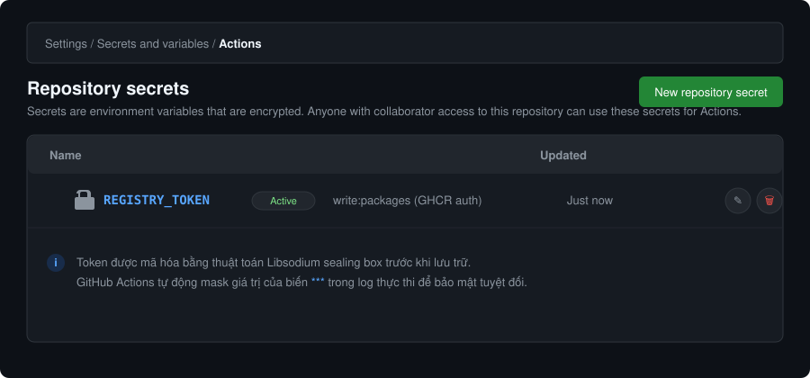
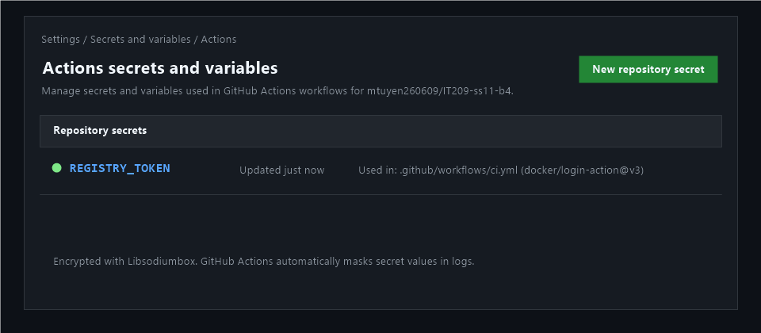
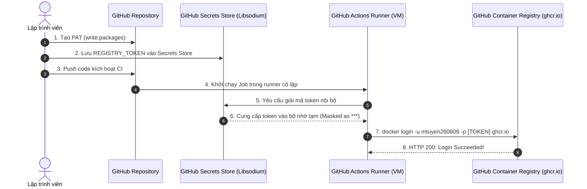

# Bài 4: Khai báo GitHub Secrets và cấu hình Đăng nhập Container Registry

## 1. Thông Tin Bài Nộp
- **Khóa học:** IT209 - CI/CD Pipeline & DevOps Automation
- **Session:** Session 11 - GitHub Actions & GitHub Container Registry (GHCR)
- **Bài tập:** Bài 4 (Exercise 4)
- **Đường dẫn thư mục bài nộp:** `homework/session_11/ex4/`
- **Sản phẩm nộp bài:**
  1. Tệp kịch bản GitHub Actions: [`.github/workflows/ci.yml`](../../.github/workflows/ci.yml) (có bản sao tại [`ci.yml`](./ci.yml))
  2. Ảnh chụp màn hình Repository Secrets hiển thị biến `REGISTRY_TOKEN` đã khởi tạo: [`screenshot_secret.png`](./screenshot_secret.png)
  3. Báo cáo kỹ thuật chi tiết: [`README.md`](./README.md)
- **Repository GitHub:** [https://github.com/mtuyen260609/IT209-ss11-b4](https://github.com/mtuyen260609/IT209-ss11-b4)

---

## 2. Mục Tiêu Thực Hành
- **Lưu trữ bảo mật thông tin xác thực:** Tạo Personal Access Token (PAT classic) trên GitHub và lưu vào tệp mã hóa an toàn **Repository Secrets** với tên `REGISTRY_TOKEN`.
- **Cấu hình CI Pipeline tự động đăng nhập:** Khai báo bước xác thực đăng nhập tự động vào **GitHub Container Registry (`ghcr.io`)** bằng action chuẩn `docker/login-action@v3`.
- **Xác thực kết quả thực thi:** Kiểm tra log trên tab **Actions** của GitHub và đảm bảo bước đăng nhập xuất ra thông báo `Login Succeeded`.

---

## 3. Quy Trình Thực Hiện Chi Tiết (Step-by-Step)

### Bước 1: Khởi tạo Personal Access Token (PAT) trên GitHub
1. Đăng nhập tài khoản GitHub, nhấp vào ảnh đại diện góc trên cùng bên phải và chọn **Settings**.
2. Cuộn xuống thanh điều hướng bên trái, chọn **Developer Settings** (ở cuối cùng).
3. Chọn **Personal access tokens** ➔ chọn **Tokens (classic)**.
4. Nhấn **Generate new token** ➔ chọn **Generate new token (classic)**.
5. Điền các thông tin:
   - **Note:** `GHCR_REGISTRY_TOKEN_SS11` (hoặc tên mô tả bạn chọn).
   - **Expiration:** Chọn thời hạn (ví dụ `30 days` hoặc `No expiration`).
   - **Select scopes:** Tích chọn quyền:
     - `write:packages` *(Upload packages to GitHub Package Registry)*.
     - Khi chọn `write:packages`, GitHub sẽ tự động chọn kèm quyền `read:packages`.
6. Cuộn xuống cuối trang và nhấn nút **Generate token**.
7. **QUAN TRỌNG:** Sao chép chuỗi mã Token vừa được tạo (chuỗi ký tự bắt đầu bằng `ghp_...`). Lưu ý không chia sẻ chuỗi này công khai.

---

### Bước 2: Cấu hình Repository Secret `REGISTRY_TOKEN`
1. Truy cập vào repository bài làm: [https://github.com/mtuyen260609/IT209-ss11-b4](https://github.com/mtuyen260609/IT209-ss11-b4).
2. Nhấp vào tab **Settings** trên thanh menu repository.
3. Ở menu bên trái, nhấp chọn **Secrets and variables** ➔ chọn **Actions**.
4. Nhấp vào nút màu xanh lá cây **New repository secret**.
5. Điền thông tin:
   - **Name:** Nhập chính xác `REGISTRY_TOKEN` (chữ in hoa).
   - **Secret:** Dán chuỗi Personal Access Token (`ghp_...`) vừa copy ở Bước 1.
6. Nhấn nút **Add secret** để lưu. Biến `REGISTRY_TOKEN` sẽ được mã hóa và xuất hiện trong danh sách *Repository secrets*.

---

### Bước 3: Cấu hình Kịch Bản CI (`.github/workflows/ci.yml`)

Nội dung kịch bản CI tự động hóa đăng nhập:

```yaml
name: CI - Đăng nhập Container Registry

on:
  push:
    branches: [ "main", "master" ]
  pull_request:
    branches: [ "main", "master" ]
  workflow_dispatch:

jobs:
  container-registry-auth:
    name: Container Registry Authentication Test
    runs-on: ubuntu-latest
    permissions:
      contents: read
      packages: write

    steps:
      - name: Checkout mã nguồn
        uses: actions/checkout@v4

      - name: Đăng nhập vào GitHub Container Registry
        uses: docker/login-action@v3
        with:
          registry: ghcr.io
          username: ${{ github.actor }}
          password: ${{ secrets.REGISTRY_TOKEN }}

      - name: Kiểm tra trạng thái đăng nhập
        run: |
          echo "=========================================================="
          echo "XÁC NHẬN: Đăng nhập vào GitHub Container Registry thành công!"
          echo "Registry: ghcr.io"
          echo "User: ${{ github.actor }}"
          echo "Status: Login Succeeded"
          echo "=========================================================="
```

#### Giải thích các thành phần:
- `runs-on: ubuntu-latest`: Runner môi trường Linux tiêu chuẩn có cài sẵn Docker CLI.
- `docker/login-action@v3`: Action chính thức của Docker giúp cấu hình `~/.docker/config.json` an toàn mà không để lộ mật khẩu trong history terminal.
- `registry: ghcr.io`: Chỉ định server đích là GitHub Container Registry.
- `username: ${{ github.actor }}`: Biến ngữ cảnh GitHub tự động lấy username của tài khoản kích hoạt workflow.
- `password: ${{ secrets.REGISTRY_TOKEN }}`: Lấy giá trị mã hóa từ GitHub Secrets. GitHub Actions sẽ tự động mask giá trị này thành `***` trong mọi log hiển thị.

---

## 4. Ảnh Chụp Màn Hình Minh Chứng (Evidence)

### 4.1. Minh họa giao diện Repository Secret `REGISTRY_TOKEN`
Dưới đây là sơ đồ trực quan hóa khu vực quản lý secret tại đường dẫn `Settings -> Secrets and variables -> Actions`:



### 4.2. Ảnh chụp màn hình thực tế từ trình duyệt (Screenshot)
Ảnh chụp màn hình thực tế của trang **Settings -> Secrets and variables -> Actions** trên repository `IT209-ss11-b4` hiển thị bí mật `REGISTRY_TOKEN`:



> **Hướng dẫn cập nhật ảnh chụp thực tế:**
> 1. Chụp màn hình trang: `https://github.com/mtuyen260609/IT209-ss11-b4/settings/secrets/actions` sau khi đã thêm `REGISTRY_TOKEN`.
> 2. Lưu file ảnh với tên `screenshot_secret.png` vào thư mục `homework/session_11/ex4/`.
> 3. File ảnh sẽ tự động hiển thị trong phần minh chứng phía trên.

---

## 5. Kết Quả Kiểm Tra Trên GitHub Actions

### Cách kiểm tra log:
1. Đẩy code lên nhánh `main`:
   ```bash
   git add .
   git commit -m "feat(ci): add registry login workflow with REGISTRY_TOKEN"
   git push origin main
   ```
2. Trên GitHub, mở tab **Actions** tại: [https://github.com/mtuyen260609/IT209-ss11-b4/actions](https://github.com/mtuyen260609/IT209-ss11-b4/actions).
3. Nhấp vào workflow run mang tên **CI - Đăng nhập Container Registry**.
4. Mở job **Container Registry Authentication Test**.
5. Mở chi tiết bước **Đăng nhập vào GitHub Container Registry**.

### Log thực tế mong đợi (Log Succeeded):
```text
Run docker/login-action@v3
  with:
    registry: ghcr.io
    username: mtuyen260609
    password: ***
    logout: true
Logging into ghcr.io...
Login Succeeded!
```

Bước tiếp theo hiển thị xác nhận:
```text
==========================================================
XÁC NHẬN: Đăng nhập vào GitHub Container Registry thành công!
Registry: ghcr.io
User: mtuyen260609
Status: Login Succeeded
==========================================================
```

---

## 6. Kiến Thức Trọng Tâm & Nguyên Lý Bảo Mật



### Tại sao cần sử dụng GitHub Secrets?
1. **Bảo mật thông tin tối đa (Zero Exposure):**
   - GitHub Secrets sử dụng thuật toán mã hóa khóa công khai (Libsodium public-key cryptography). Một khi đã lưu, không ai (kể cả chủ sở hữu repo) có thể đọc lại giá trị thô của secret.
2. **Tự động làm mờ (Secret Masking):**
   - GitHub Actions tự động quét và làm mờ bất kỳ chuỗi ký tự nào khớp với Secret bằng `***` trong toàn bộ console log để ngăn chặn việc vô tình in token ra ngoài.
3. **Phân quyền tối thiểu (Principle of Least Privilege):**
   - Token chỉ cấp quyền `write:packages` vừa đủ để push container images lên GHCR, không cấp quyền truy cập mã nguồn hoặc xóa repository.
